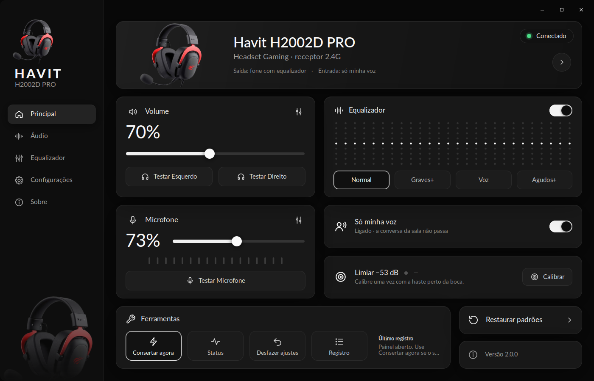
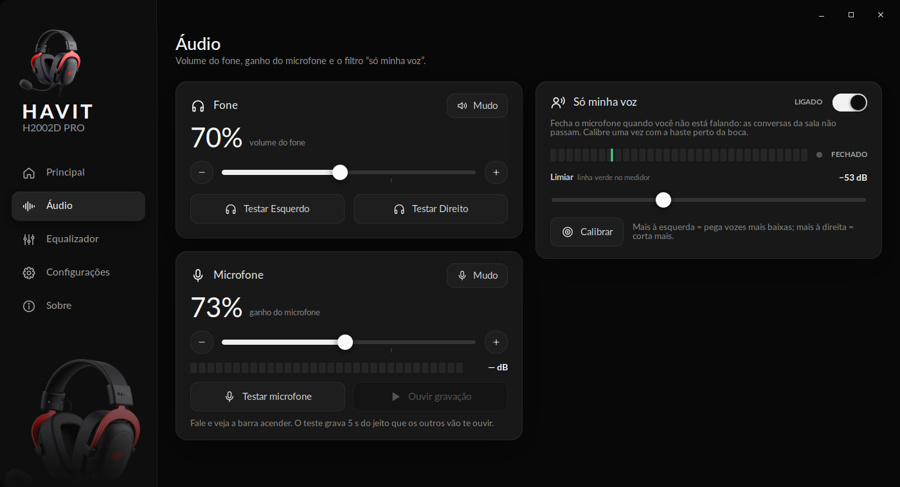

# Fone Havit H2002D Pro no Ubuntu

Conserto e painel para usar o headset sem fio **Havit H2002D Pro** no **Ubuntu 22.04**, pelo receptor USB 2.4G
ou pareado direto no **Bluetooth**.



## Por que este projeto existe

Com o receptor USB ligado no Ubuntu 22.04, o fone apresentava três problemas:

- **o lado direito não tocava nada**, só o esquerdo;
- **o microfone não captava a voz**, mesmo aparecendo nas configurações de som;
- o volume e o microfone **voltavam a falhar** toda vez que o receptor era tirado e posto de novo.

Não é defeito do fone: é a forma como o receptor se apresenta ao Linux.

## A incompatibilidade, explicada de forma simples

O receptor do fone conta ao Linux qual é a faixa de volume dele. Só que **ele informa números falsos**:

| Controle do receptor | Faixa que ele informa | O que acontece |
|---|---|---|
| `PCM` (volume do fone) | 0 a 0,39 dB | O PulseAudio grava 0 no hardware, e com 0 o receptor **cala o lado direito** |
| `Mic` (microfone) | 0 a 0,12 dB | Com o ganho abaixo de 100%, o PulseAudio grava 0 e o receptor **corta o microfone** |

Uma faixa de volume tão pequena faz o PulseAudio (o sistema de som do Ubuntu) achar que qualquer volume abaixo do
máximo é praticamente zero. Ele então grava **0** no volume de hardware do receptor. Só que esse receptor não trata o 0
como "volume baixo": o firmware dele **desliga o canal direito** e **corta o microfone**.

Outros detalhes pioram a situação:

- no perfil **"Estéreo digital (IEC958)"**, que aparece como opção nas Configurações, o PulseAudio nem mexe nesse
  controle, e ele fica no 0 em que o receptor liga;
- o volume geral do receptor (`PCM,1`) **volta para 0 a cada reconexão**.

## A solução

O conserto não altera nenhum arquivo do sistema. Ele cria **arquivos de ajuste do mixer só para o seu usuário**
(em `~/.local/share/pulseaudio/alsa-mixer/paths/`). Esses arquivos dizem ao PulseAudio para deixar o `PCM` e o `Mic`
do receptor **sempre no máximo do hardware**, e o volume passa a ser controlado em software pelo próprio PulseAudio.
Depois disso os dois lados tocam, o microfone capta e a correção continua valendo após reiniciar ou reconectar o
receptor.

Ele também acerta o perfil (estéreo analógico + microfone), escolhe o fone como saída e entrada padrão e manda para o
fone os programas que já estavam tocando.

## E pelo Bluetooth?

O defeito do volume é do **receptor USB**. Pareado direto no Bluetooth do computador, o fone não passa por ele, então
esse problema não acontece. O painel e o conserto também funcionam por Bluetooth: sem o receptor no USB, eles usam o
fone pareado (o nome Bluetooth precisa conter "H2002" ou "Havit"). Se ele estiver pareado mas desconectado, o
conserto tenta conectar sozinho.

O Bluetooth tem uma limitação que não depende do projeto: ele tem **dois modos**, e o painel mostra os botões para
trocar entre eles:

| Modo | Som | Microfone |
|---|---|---|
| **Música** (A2DP) | estéreo, boa qualidade | desligado |
| **Chamada** (HFP/HSP) | mono, mais simples | ligado |

O teste de microfone e o "Só minha voz" só funcionam no modo **Chamada**. O equalizador funciona nos dois. Na troca
de modo, o painel leva junto o que estava tocando e o "Só minha voz".

> Testado com o fone de verdade nos dois jeitos. Pelo Bluetooth ele aparece como "H2002d Pro": no modo Música o
> som é estéreo (SBC); no modo Chamada (HFP) a saída e o microfone ficam em 16 kHz mono, e a troca leva menos de
> meio segundo.

## O que vem no projeto

- **`consertar-fone-havit.sh`**: instala o que faltar e conserta o som. É o único arquivo que precisa ser executado.
- **`havit-fone.py`**: o painel **Fone Havit**, com:
  - volume do fone e ganho do microfone, com botão de mudo;
  - teste do lado esquerdo e do direito;
  - teste do microfone com medidor de nível e gravação para ouvir;
  - **equalizador** (graves e agudos) com presets Normal, Graves+, Voz e Agudos+;
  - **"Só minha voz"**: fecha o microfone quando você não está falando, para as conversas da sala não passarem
    (com calibração automática);
  - botões para consertar, ver o status e desfazer a correção.



## Como instalar

Funciona no **Ubuntu 22.04** com o sistema de som padrão dele (PulseAudio).

1. Baixe o projeto (botão **Code → Download ZIP**, ou `git clone`) e coloque a pasta onde ela vai ficar, por exemplo
   na sua pasta pessoal.
2. Abra o Terminal (Ctrl+Alt+T) e rode:

   ```bash
   bash ~/fone-havit-ubuntu/consertar-fone-havit.sh
   ```

   Troque o caminho se você salvou a pasta em outro lugar ou com outro nome.
3. Se faltar algum pacote, o script pede a sua senha e instala **só o que falta**. Nada que já está instalado é
   atualizado.
4. Conecte o receptor USB e ligue o fone no modo 2.4G. Se o receptor não estava conectado na instalação, rode o
   atalho **Consertar fone Havit** depois de conectar.

No fim aparecem dois atalhos, no menu de aplicativos e na Área de Trabalho: **Fone Havit**, que abre o painel, e
**Consertar fone Havit**, que roda o conserto de novo.

Mais detalhes (o que é instalado, onde fica cada arquivo e outros comandos) estão no [LEIA-ME.txt](LEIA-ME.txt).

## Como desfazer

```bash
consertar-fone-havit --desfazer
```

Esse comando remove os ajustes do mixer. Para valer, tire e ponha o receptor USB de novo.

## Compatibilidade

- Testado com o receptor USB `040b:0897`, que aparece como *XiiSound Technology Corporation H2002d Pro*
  (para conferir: `lsusb | grep 040b:0897`).
- Bluetooth: o fone precisa estar pareado em **Configurações → Bluetooth**, com um nome que contenha "H2002" ou
  "Havit".
- Feito para Ubuntu 22.04 com PulseAudio. Em sistemas com PipeWire o script avisa que pode não funcionar igual.

---

Projeto pessoal e não oficial, sem ligação com a Havit.
